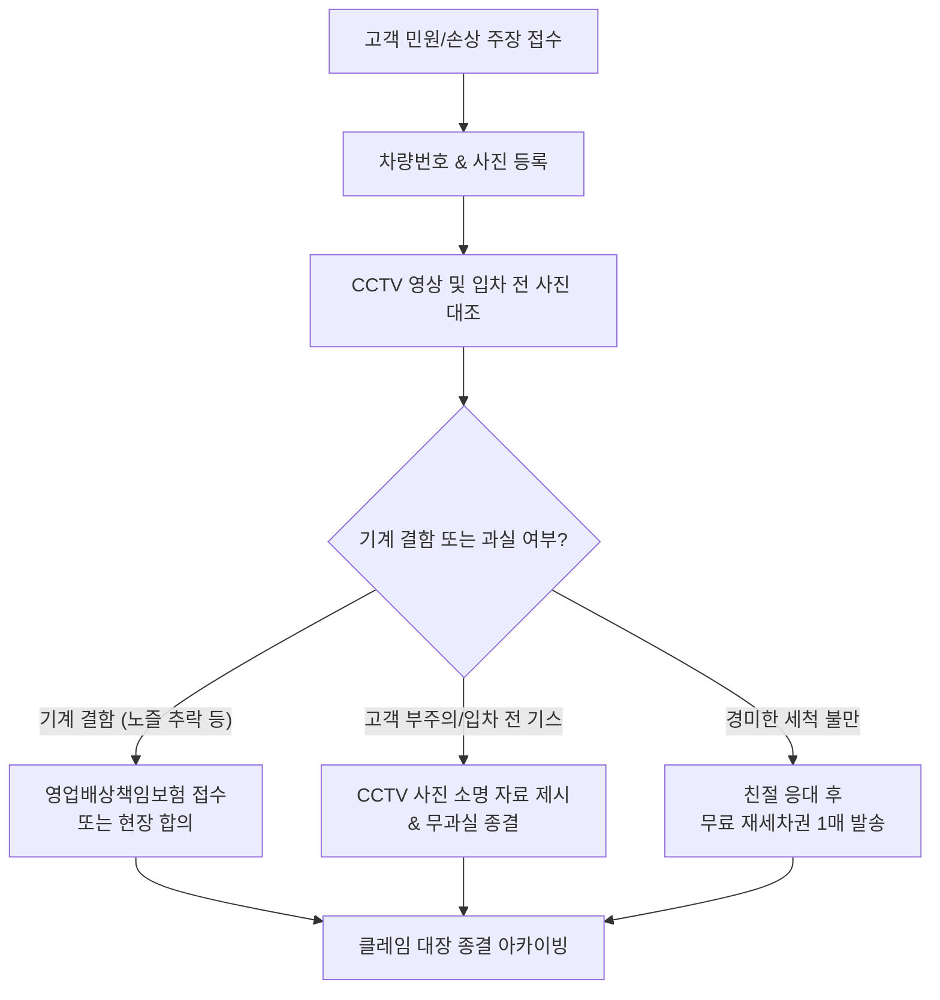

# 04. 고객 & 도장 민원/CS 분쟁 관리 모듈 기획서 (Customer Claims Specification)

> **상위 기획서**: [세차장 통합 운영관리 시스템 PRD](../carwash-integrated-operations-prd.md)  
> **모듈 코드**: `MOD-04-CS`  
> **우선순위**: A급 (현장 필수)

---

## 1. 개요 및 목적
세차장 운영에서 가장 큰 스트레스이자 금전적 손실을 유발하는 요인은 **"차량 도장 스크래치 / 휠 손상 분쟁"**입니다. 
입차 전에 이미 존재하던 스크래치를 세차 후 발견하여 점주에게 배상을 요구하는 경우가 빈번합니다.
본 모듈은 **차량별 클레임 이력 대장**, **입차 전 사진 및 CCTV 확인 체크리스트**, **배상/종결 이력 관리**를 통해 악성 민원과 부당한 배상금 지출을 객관적 증빙으로 방어합니다.

---

## 2. 주요 클레임 유형 및 현장 대응 매뉴얼

| 클레임 유형 | 고객 주장 내용 | 객관적 점검 및 방어 방법 |
| :--- | :--- | :--- |
| **도장면 스크래치** | "세차기 돌리고 나서 문짝에 기스가 났다" | 노터치 세차는 브러시가 없어 물리적 스크래치 불가 안내 + 입차 전 LPR 카메라 사진 대조 |
| **휠/타이어 손상** | "진입 가이드 레일에 휠이 긁혔다" | 진입 유도선 이탈 여부 CCTV 확인 + 규정 타이어 폭/편평비 규정 안내문 확인 |
| **부품 파손/탈락** | "와이퍼나 루프박스가 부러졌다" | 세차 전 주의사항(와이퍼 테이핑, 안테나 접기) 미준수 고지 이행 기록 대조 |
| **세척 불량/물자국**| "하부에 때가 그대로 남아있다" | 고객 코스 확인(하부 옵션 미포함 여부) + 드라잉존 안내 및 무료 1회 재세차 쿠폰 제공 |
| **결제/요금 오류** | "카드가 2번 긁혔다 / 거스름돈 미출력" | 결제 시각 키오스크 승인 내역 조회 → 밴사 승인 취소 즉시 처리 |

---

## 3. 핵심 입력 필드 및 데이터 구조

| 필드명 | 타입 | 필수여부 | 설명 및 예시 |
| :--- | :--- | :---: | :--- |
| `claimId` | String | 자동생성 | 클레임 고유 번호 (`CLM-20261109-01`) |
| `incidentDate` | DateTime | 필수 | 사고/민원 발생 일시 |
| `carNumber` | String | 필수 | 차량 번호 (예: `12가 3456`) |
| `carModel` | String | 필수 | 차종 및 색상 (예: `GV80 우유니 화이트`) |
| `claimType` | Enum | 필수 | `scratch`(스크래치), `wheel`(휠손상), `parts`(부품파손), `wash_quality`(세척불만), `payment`(결제오류) |
| `customerName` | String | 선택 | 고객 성함 및 연락처 |
| `damageDescription`| Text | 필수 | 고객 주장 내용 및 손상 부위 설명 |
| `cctvChecked` | Boolean | 필수 | 매장 CCTV 동선 및 전치 여부 확인 완료 |
| `photoEvidenceUrl`| String[] | 선택 | 손상 부위 및 입차 전 사진 파일 경로 |
| `resolutionStatus`| Enum | 필수 | `reported`(접수), `investigating`(조사중), `compensated`(보상완료), `closed_no_fault`(무과실종결) |
| `settlementCost` | Number | 선택 | 실제 배상액 또는 쿠폰 지급 상당액 (원) |
| `actionTakenNotes`| Text | 선택 | 조치 결과 상세 메모 (합의 내용, 보험 접수번호) |

---

## 4. 분쟁 방어 워크플로우

---

## 5. UI 화면 구성

- **클레임 관리 대장 뷰**: 차량번호 검색 시 과거 방문 횟수 및 이전 클레임 이력 즉시 조회
- **민원 등록 팝업**: 현장에서 태블릿/스마트폰으로 차량 사진 촬영 후 즉시 첨부
- **소명 자료 인쇄**: 고객 또는 보험사 제출용 '사고 경위 및 CCTV 분석 소명서' 출력
