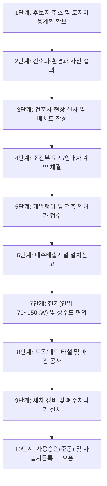

# [기획서] 세차장 창업 로드맵 앱 (Carwash Startup Roadmap App)

> **카테고리**: 04 창업 서비스 (B급 · 수익화)  
> **앱 ID**: `app-startup-roadmap`  
> **목적**: 토지 검토부터 인허가, 토목·건축 공사, 장비 발주, 시운전, 그랜드 오픈까지의 20단계 전 과정을 체크리스트와 일정표로 안내

---

## 1. 서비스 개요 및 타깃
- **대상 사용자**: 세차장 신규 창업을 준비하는 예비 점주, 토지주, 컨설턴트
- **핵심 가치**:
  - "어디서부터 시작해야 하지?"라는 막막함 해소 (순서 역전 방지: 계약 먼저 했다가 허가 안 나와 계약금 날리는 사고 방어)
  - 20단계별 관할 관청(건축과, 도시계획과, 환경과, 하수도과) 및 필수 구비 서류 가이드
  - 단계별 증빙 파일(건축물대장, 토지이용계획원, 협의 공문) 보관

---

## 2. 20단계 표준 창업 프로세스



---

## 3. 데이터 스키마

```typescript
export interface StartupProject {
  projectId: string;
  projectName: string;          // "화성 남양 3베이 노터치 창업"
  targetAddress: string;
  stageProgress: {
    [stageNumber: number]: {
      stageName: string;
      isDone: boolean;
      status: 'pending' | 'in_progress' | 'approved' | 'rejected';
      agencyInCharge: string;   // 예: "화성시 환경지도과"
      dueDate: string;
      budgetAllocated: number;  // 단계별 예상 비용
      actualSpent: number;      // 실제 지출액
      attachedFiles: string[];  // 증빙 문서 경로
      notes: string;
    };
  };
}
```
